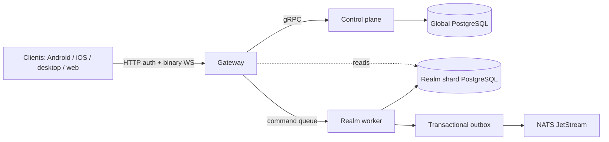

## Maintenance: complete world gameplay

- Defeated monsters are now filtered out of map snapshots; they reappear only
  on respawn. Golden test added.
- Added a durable recurring `monster_spawn` event (armed at world seeding,
  re-armed every 15 minutes) that places new monsters on passable free ground
  with distance-scaled levels and publishes `monster.spawned`. Golden test added.
- Reworked world seeding: eight independently hashed slots per chunk, terrain
  checks and level scaling by distance from the world centre.
- Speedup items are now covered by a golden test proving an active build queue
  is shortened and the item consumed.
- Map rendering shows HP bars for monsters/forts and resource subtypes.
- Verified on a physical tablet: ONLINE session, real city state, and world map
  with 38 beasts / 47 resource sites, level labels and HP bars.

## Maintenance: webhook reconciliation

- Added `POST /admin/reconcile`: scans pending payments, verifies Stripe Checkout
  Session `payment_status` in live mode (stub treats pending as paid in dev) and
  fulfills through the same idempotent path. Requires `x-kd-internal` when
  configured; documented for cron use in `docs/PAYMENTS.md`.
- Added a reconciliation regression test (10 payments unit tests + 2 DB tests).

## Maintenance: feature-evidence regression tests + payment trust

- Added 3 domain tests proving research/building/hero modifiers change economy
  and combat values, and 3 golden tests proving healing converts wounded to
  troops, completed research changes real realm modifiers, and scheduled
  monster-respawn events fire with an outbox event while offline. Golden suite
  is now 13 tests.
- Payments checkout now requires a signed `x-kd-account-signature` when
  `KD_INTERNAL_SECRET` is configured, closing the caller-supplied account_id
  trust gap; 1 HTTP regression test added (9 unit + 2 DB tests total).

## Maintenance: persistent payments, hardening and dead-code sweep

- Payments store is now PostgreSQL-backed (`migrations/payments/001_init.sql`):
  payments and grants survive restarts, fulfillment is idempotent under
  concurrent webhook/stub delivery via a transaction + row lock. A dev-only
  in-memory backend remains when `KD_PAYMENTS_DB_URL` is unset. Added 2 real-DB
  tests (restart persistence, concurrent double-grant) — both pass.
- Added fail-fast payment config validation: live Stripe key requires a signing
  secret and an HTTPS public URL; zero replay window is rejected. 3 new tests.
- CI payments tests now total 8 unit + 2 DB tests.
- Removed ~20 unused dependencies across 9 crate manifests, deleted stale IDE
  and log artifacts, and removed the now-unneeded `urlencoding` dependency
  (JWTs are query-safe). `cargo clippy --workspace --all-targets -D warnings`
  and a dead-code dependency audit are both clean.
- Config guard tests and a full reskin proof ("Aether Realms", 25 Flutter tests
  passing) are recorded above.
- Six-target build sweep attempted: web, Linux and Android APK pass locally.
  iOS/macOS/Windows cannot build on this Linux host (Flutter rejects the target
  flags / reports "only supported on Windows hosts"); those targets are covered
  by the macOS/Windows CI jobs.

# Kingdoms of Dominion

<!-- Replace OWNER/REPO with the GitHub slug when the repository is published. -->
[](https://github.com/OWNER/REPO/actions/workflows/ci.yml)
[](LICENSE)
[](rust-toolchain.toml)
[](clients/game/pubspec.yaml)

A persistent, real-time, authoritative multiplayer **4X game** built as a
reference implementation. The server is a Rust/Tokio workspace; the client is a
single Flutter + Flame codebase that builds natively for **Android, iOS,
Windows, macOS and Linux**, plus web. All art is generated geometric
primitives, so the repository is self-contained.

> **Scope.** This repository implements the local acceptance contract in
> [`goal.md`](goal.md). Production-scale (1M CCU), app-store signing,
> physical-device certification and cross-region HA are **not** claimed as
> validated. See [`ACCEPTANCE.md`](ACCEPTANCE.md) and
> [`docs/capacity.md`](docs/capacity.md).

---

## Contents

- [Why this project exists](#why-this-project-exists)
- [Feature tour](#feature-tour)
- [Make it your own (reskin)](#make-it-your-own-reskin)
- [Architecture](#architecture)
- [Repository layout](#repository-layout)
- [Prerequisites](#prerequisites)
- [Quickstart (5 minutes)](#quickstart-5-minutes)
- [Building the native clients](#building-the-native-clients)
- [Testing](#testing)
- [Development workflow](#development-workflow)
- [Configuration](#configuration)
- [Deployment and observability](#deployment-and-observability)
- [Documentation map](#documentation-map)
- [Contributing](#contributing)
- [License](#license)

---

## Why this project exists

Most 4X game examples stop at a local simulation. This one demonstrates the
parts that are hard to get right when many players share one world:

- **Authoritative, fenced mutation ownership** — exactly one realm worker may
  write a realm at a time; an epoch/lease check inside every transaction makes
  a stale worker unable to commit.
- **Deterministic economy and combat** — integer-only math with persisted
  fractional remainders, so results do not depend on polling frequency.
- **Durable discrete-event scheduler** — timed build queues, marches and
  monster respawns survive restarts.
- **Transactional outbox** — committed gameplay events reach NATS JetStream
  with stable message IDs; a broker outage leaves rows pending, never lost.
- **Filtered, reconnectable streaming** — chunk subscriptions, private/ally
  visibility, snapshot/delta gap recovery over one binary WebSocket.
- **One protocol, six platforms** — generated protobuf bindings keep server and
  client in lockstep.

## Feature tour

Cities and a five-resource economy with lazy accrual; 12 buildings × 20 levels;
14 technologies × 3 levels; 15 unit stacks; 6 heroes; items and speedups;
deterministic combat with wounded/dead units and bounded loot; five monster
tiers; finite replenishing resource nodes; forts, territory and season scoring;
shared marches with recall; PvP siege and subordinate capture; reinforcement and
transport; and alliances with roles, help, rallies and chat. Every action is a
typed command reachable from the Flutter UI.

The complete rule set is in [`docs/rules.md`](docs/rules.md) and the wire format
in [`docs/protocol.md`](docs/protocol.md).

## Architecture



| Component | Responsibility | Storage |
| --- | --- | --- |
| `control-plane` | Accounts (Argon2id), revocable JWT sessions, realm directory, membership provisioning | Global PostgreSQL only |
| `gateway` | Stateless HTTP auth/bootstrap and WebSocket streaming; authenticates the WebSocket upgrade, enforces realm scope, rate limits and visibility filters. Never writes gameplay tables | None |
| `realm-worker` | The single fenced mutation owner per realm; command queue and durable event scheduler | Realm shard |
| `outbox-worker` | Publishes committed outbox rows to JetStream with stable message IDs | Reads realm shards |
| `loadgen` | Headless protocol-level load generator for smoke and staged profiles | None |
| `Valkey` | Disposable presence/rate-limit state — never an authority | Volatile |

Two independent realm shards run in Compose to prove that routing and
isolation work. There are no cross-shard joins in the hot path.

## Repository layout

```
proto/                  canonical protobuf schema (Rust + Dart generated from it)
crates/kd-domain        pure content, world generation, economy and combat math
                        └── content/{resources,buildings,research,troops,heroes,
                            items,modifiers}.rs — one catalog per domain
crates/kd-common        config, auth, errors, observability
crates/kd-store         SQLx pools and versioned migrations (global + realm)
crates/kd-engine        fenced engine: commands, scheduler, outbox, snapshots
                        └── commands/{city,movement,alliance,rally,events,
                            combat,logistics,progression}.rs
crates/kd-proto         prost/tonic generated bindings
services/               thin binaries with focused modules:
                        ├── gateway/       main + app/state + http/handlers + session/WS
                        ├── control-plane/ main + service/gRPC + seed/directory
                        ├── realm-worker/  main + service/gRPC
                        ├── loadgen/       main/run-loop + client/config/commands
                        ├── outbox-worker/ relay loop
                        └── payments/      Stripe checkout + signed webhook
clients/game            one Flutter/Dart + Flame app (6 platform runners)
                        ├── main.dart    entry point and global theme only
                        ├── auth.dart    session and realm-selection screens
                        ├── screens.dart library facade over the ui/ parts
                        └── ui/          one part per feature (shell, city, world, …)
migrations/             versioned SQL
deploy/                 Kubernetes manifests + OpenTofu example
monitoring/             Prometheus rules + Grafana dashboard
scripts/                codegen, local run, backup/restore, benchmark helpers
docs/                   architecture, rules, threat model, capacity, runbooks, ADRs
```

Keeping each domain in its own module is deliberate: the engine's command
handlers are grouped by gameplay feature, the content catalogs by data domain,
and the Flutter UI by screen. Hand-written source files stay in the low hundreds of lines (generated
protobuf bindings are the exception); see `CONTRIBUTING.md` for where new code belongs.

## Make it your own (reskin)

This repository is a generator, not just a game. Branding, colours, labels and
art live in **`game.config.json`** and **`clients/game/assets/art/`**; gameplay
lives in Rust and never reads either. To ship your own themed game:

```bash
# 1. edit game.config.json (name, tagline, colours, labels, asset filenames)
# 2. replace the PNGs in clients/game/assets/art/
make generate     # validates config + assets, writes lib/game_config.dart
make check        # full verification
```

An AI agent can do the whole reskin from those two locations without touching
gameplay code. See [`docs/RESKIN.md`](docs/RESKIN.md) for the asset contract and
a ready-to-use agent prompt. Stripe setup is documented in
[`docs/PAYMENTS.md`](docs/PAYMENTS.md).

## Prerequisites

| Tool | Version | Needed for |
| --- | --- | --- |
| Rust | 1.99.0 (pinned in [`rust-toolchain.toml`](rust-toolchain.toml)) | Server |
| `protoc` | 36.x | Regenerating protobuf bindings |
| Docker Engine + Compose | Engine 24+, Compose v2+ | Local stack / CI |
| Flutter | 3.50.0 / Dart 3.14.0 | Client |
| `psql` / `pg_dump` | 16+ | Optional manual DB inspection and backup test |

> The client build for a given platform requires that platform's toolchain:
> Xcode for iOS/macOS, the Android SDK + JDK 17 for Android, and Visual Studio
> build tools for Windows. Linux and web build on a stock Ubuntu installation
> with the packages listed in the CI workflow.

## Quickstart (5 minutes)

```bash
# 1. Start infrastructure and all services (builds the Rust image once).
docker compose up -d --build

# 2. Verify the gateways and realm directory.
curl -s http://localhost:8080/health   # ok
curl -s http://localhost:8080/realms   # realm-a, realm-b on separate shards

# 3. Run the client (web shown; native targets use the same code and protocol).
cd clients/game
flutter pub get
flutter run -d chrome --dart-define=KD_GATEWAY=http://localhost:8080
```

Sign in with one of the development accounts seeded in `dev_mode`:

| Account | Password |
| --- | --- |
| `alice` | `password123` |
| `bob` | `password123` |

Pick a realm, found your city, then use the **game features** menu to build,
research, train troops, open the world map and chat. `scripts/run_host.sh` runs
the services as host binaries against the Compose infrastructure for faster
iteration (run `cargo build --workspace` first).

## Building the native clients

The Flutter client lives in [`clients/game`](clients/game). The gateway URL is
compiled in with `--dart-define=KD_GATEWAY=...`; use your workstation's LAN IP
instead of `localhost` when testing on a physical device or emulator.

| Target | Command | Notes |
| --- | --- | --- |
| Android | `make client-build-android` | Produces `build/app/outputs/flutter-apk/app-release.apk`. Requires JDK 17 + Android SDK. |
| iOS | `make client-build-ios` | `--no-codesign`; requires macOS + Xcode. Signing is deliberately out of scope. |
| Windows | `make client-build-windows` | Requires Visual Studio with the C++ desktop workload. |
| macOS | `make client-build-macos` | Requires macOS + Xcode. |
| Linux | `make client-build-linux` | Bundle in `build/linux/x64/release/bundle`. |
| Web | `make client-build-web` | Static output in `build/web`. |

Override the Flutter binary if it is not on your `PATH`:
`make client-test FLUTTER=/path/to/flutter`.

CI builds **all six targets** on the appropriate runners and uploads each
artifact. Device-level integration tests need a running backend and a real
emulator/simulator; the harness is
[`clients/game/integration_test/app_test.dart`](clients/game/integration_test/app_test.dart)
and is documented in [`ACCEPTANCE.md`](ACCEPTANCE.md).

## Testing

```bash
make check              # all fast checks: Rust fmt/clippy/tests + Dart format/analyze/tests
make test-integration   # real PostgreSQL tests (start the DB services first)
```

Or run the individual layers:

```bash
# Pure domain and property tests — no services required.
cargo test --workspace --lib --bins

# Real-PostgreSQL integration tests (fencing, idempotency, scheduler, outbox, PvP).
docker compose up -d global-db realm-db-a nats valkey
KD_TEST_DB_A=postgres://kd:kd@localhost:15433/kd_realm_a \
  cargo test -p kd-engine --test engine -- --test-threads=2
KD_TEST_DB_A=postgres://kd:kd@localhost:15433/kd_realm_a \
  cargo test -p kd-engine --test multiplayer -- --test-threads=2

# Golden happy path + new features (settlement, market, demolish, alliances…).
KD_TEST_DB_A=postgres://kd:kd@localhost:15433/kd_realm_a \
  cargo test -p kd-engine --test golden -- --test-threads=1

# Flutter unit and widget tests (auth, all 11 feature screens, offline guard).
cd clients/game && flutter test

# Protocol-level smoke load through the real HTTP/WS/protobuf stack.
cargo run -p loadgen -- --gateway http://localhost:8080 --realm realm-a \
  --clients 20 --duration 60 --actions-per-sec 2 --prefix smoke --seed 100
```

Protobuf bindings are reproducible from the single canonical schema:

```bash
make gen-dart   # proto/kd.proto -> clients/game/lib/proto/*.dart
```

## Development workflow

[`Makefile`](Makefile) is the single entry point, and each target mirrors a CI
step. Quality is enforced by configuration, not convention:

| Concern | Configuration |
| --- | --- |
| Rust formatting | [`rustfmt.toml`](rustfmt.toml) — `cargo fmt --all` |
| Rust linting | [`clippy.toml`](clippy.toml) + `-D warnings` in CI |
| Dart formatting | `dart format .` (enforced with `--set-exit-if-changed`) |
| Dart linting | [`clients/game/analysis_options.yaml`](clients/game/analysis_options.yaml) — `flutter_lints` plus strict casts/inference/raw types |
| Editor settings | [`.editorconfig`](.editorconfig) |
| CI | [`.github/workflows/ci.yml`](.github/workflows/ci.yml) |

## Configuration

All services read their configuration from environment variables; see
[`scripts/env.sh`](scripts/env.sh) for the full local development set. The most
important ones are `KD_JWT_SECRET`, `KD_INTERNAL_SECRET`, `KD_CORS_ORIGIN`,
`KD_DEV_MODE`, `KD_GLOBAL_DB_URL`, `KD_SHARD_DBS__*`, `KD_REALMS`,
`KD_NATS_URL` and `RUST_LOG`. With `KD_DEV_MODE=false` the loader refuses the
default JWT secret, a wildcard CORS origin and the default internal secret.

Host ports are deliberately remapped from the defaults because many
workstations already run PostgreSQL:

| Port | Service | Port | Service |
| --- | --- | --- | --- |
| 15432 | Global PostgreSQL | 4222 | NATS |
| 15433 / 15434 | Realm shards A / B | 8222 | NATS monitoring |
| 8080 / 8081 | Gateways | 6379 | Valkey |
| 8082 | Control plane HTTP | 50051 | Control plane gRPC |
| 8083 | Outbox worker HTTP | 50052 / 50053 | Realm workers |

## Deployment and observability

- [`deploy/kubernetes`](deploy/kubernetes) — namespace, stateless services,
  stateful workers and network policies.
- [`deploy/opentofu`](deploy/opentofu) — a minimal infrastructure example.
- [`monitoring`](monitoring) — Prometheus alert rules and a Grafana dashboard.
- [`scripts/backup_restore.sh`](scripts/backup_restore.sh) — verifies a dump /
  restore round trip against a scratch database.
- [`docs/runbooks.md`](docs/runbooks.md) — operational procedures.

Compose config, Kubernetes manifests and the OpenTofu example are checked on every CI run.

## Documentation map

| Document | What it covers |
| --- | --- |
| [`docs/architecture.md`](docs/architecture.md) | Components, boundaries and data flow |
| [`docs/rules.md`](docs/rules.md) | Game rules and constants |
| [`docs/protocol.md`](docs/protocol.md) | Wire protocol and command catalogue |
| [`docs/threat-model.md`](docs/threat-model.md) | Threats and mitigations |
| [`docs/decisions.md`](docs/decisions.md) | Architecture decision records |
| [`docs/capacity.md`](docs/capacity.md) | Measured capacity and load profiles |
| [`docs/runbooks.md`](docs/runbooks.md) | Day-two operations |
| [`docs/RESKIN.md`](docs/RESKIN.md) | Generate a themed game from config + assets |
| [`docs/PAYMENTS.md`](docs/PAYMENTS.md) | Stripe checkout, webhooks and dev stub |
| [`docs/deployment.md`](docs/deployment.md) | Deployment guide |
| [`ACCEPTANCE.md`](ACCEPTANCE.md) | Local acceptance evidence and gaps |
| [`PROGRESS.md`](PROGRESS.md) | Milestone history |

## Contributing

See [`CONTRIBUTING.md`](CONTRIBUTING.md) for the workflow and
[`SECURITY.md`](SECURITY.md) for responsible disclosure. In short: keep
`proto/kd.proto` canonical, keep gameplay writes inside the realm worker,
keep economy/combat math integer-only, and run `make check` before opening a PR.

## License

[MIT](LICENSE) © 2026 Elizabeth Hayes.
